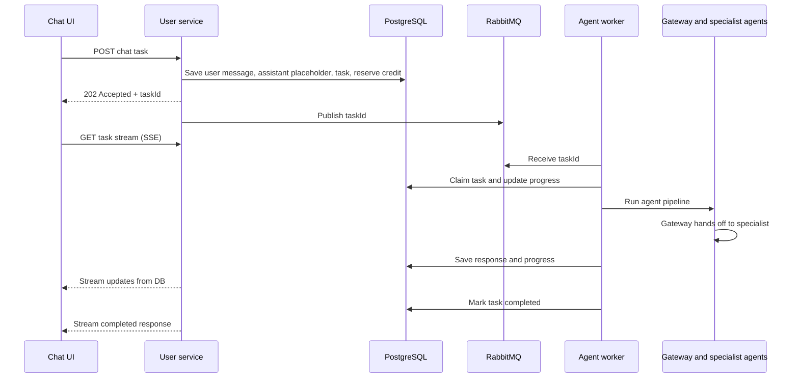

## Architecture overview

The flow has two kinds of handoff:

1. **Chat task handoff:** the user service queues a complete chat turn for background processing. RabbitMQ delivers it to an agent worker.
2. **Specialist handoff:** inside that worker, the gateway agent routes the request to a specialist through the agent SDK. That specialist work happens within the same task; RabbitMQ does not create a separate message for each specialist.

### From send to queued task

`ChatDetails.tsx` calls the task API when the user sends a message. It adds an assistant placeholder immediately and starts watching the task stream. If the page reloads, it looks for pending tasks and reconnects.

The API call is implemented in [`chats.service.ts`](/C:/Users/BCT-REN-2026-08-025/Desktop/CODING/Personal/Med_GPT/Client/src/api/chats/chats.service.ts:290). It creates the task, opens the SSE stream, and can cancel it. [`Message.tsx`](/C:/Users/BCT-REN-2026-08-025/Desktop/CODING/Personal/Med_GPT/Client/src/components/Message.tsx:86) renders the queued, routing, handed-off, and generating states.

On the server, `POST /:id/tasks` is registered in [`chat.routes.ts`](/C:/Users/BCT-REN-2026-08-025/Desktop/CODING/Personal/Med_GPT/Server/user_service/src/routes/chat.routes.ts:19). [`message.service.ts`](/C:/Users/BCT-REN-2026-08-025/Desktop/CODING/Personal/Med_GPT/Server/user_service/src/services/message.service.ts:19) verifies chat ownership, reserves a credit, and saves the user message, assistant placeholder, and task in one database transaction. The task stores the input and conversation context in PostgreSQL.

The `AgentTask` model is in [`schema.prisma`](/C:/Users/BCT-REN-2026-08-025/Desktop/CODING/Personal/Med_GPT/Server/user_service/prisma/schema.prisma:119). Its migration is [`migration.sql`](/C:/Users/BCT-REN-2026-08-025/Desktop/CODING/Personal/Med_GPT/Server/user_service/prisma/migrations/20261026100000_agent_tasks/migration.sql). The schema is also present in the agent service so its generated Prisma client can access task records.

### RabbitMQ delivery and background processing

The user service’s [`agent-task.publisher.ts`](/C:/Users/BCT-REN-2026-08-025/Desktop/CODING/Personal/Med_GPT/Server/user_service/src/services/agent-task.publisher.ts:41) periodically looks for queued tasks and publishes persistent messages to RabbitMQ. The queue message contains the task ID; PostgreSQL remains the source for the task and conversation data. The publisher also recovers tasks whose worker lease expired and handles post-completion compaction.

[`index.ts`](/C:/Users/BCT-REN-2026-08-025/Desktop/CODING/Personal/Med_GPT/Server/user_service/index.ts:72) starts that publisher with the user service.

The separate [`worker.ts`](/C:/Users/BCT-REN-2026-08-025/Desktop/CODING/Personal/Med_GPT/Server/Agent_backend_service/worker.ts:245) process consumes the queue with a prefetch of one task at a time. It claims each task in PostgreSQL, renews a lease while processing, writes progress and response text, and acknowledges the RabbitMQ delivery after processing. If a worker disappears, the expired lease lets the publisher enqueue the task again. Failures retry up to three attempts; terminal failure or cancellation returns the reserved credit.

### Specialist routing and streaming

The worker calls `streamAgentPipeline` directly from the agent service code. In [`src/agents/index.ts`](/C:/Users/BCT-REN-2026-08-025/Desktop/CODING/Personal/Med_GPT/Server/Agent_backend_service/src/agents/index.ts:99), the pipeline observes SDK handoff events, reports progress as the active agent changes, and streams the specialist’s response. It suppresses gateway narration after a handoff so text like “I transferred your request” does not become the final answer. If the gateway finishes without actually invoking a handoff, it selects a specialist fallback.

The gateway’s available specialist handoffs are configured in [`gateway.agent.ts`](/C:/Users/BCT-REN-2026-08-025/Desktop/CODING/Personal/Med_GPT/Server/Agent_backend_service/src/agents/gateway/gateway.agent.ts:89). RabbitMQ dispatches the user’s overall task to a worker; the gateway and specialist agents then run as part of that task.

### Getting progress back to the browser

The browser opens the authenticated SSE endpoint, `GET /:id/tasks/:taskId/stream`. [`messageController.ts`](/C:/Users/BCT-REN-2026-08-025/Desktop/CODING/Personal/Med_GPT/Server/user_service/src/controllers/messageController.ts:52) polls the task and assistant message in PostgreSQL, then sends changed content and status to the browser. This lets the stream reconnect after a refresh without relying on an in-memory connection to the worker. The same controller provides task cancellation.

### Where Redis fits

I found **no Redis service or Redis use in this handoff flow**. The user service lists `ioredis` as a dependency, and a web-search agent comment mentions Redis caching, but there are no Redis imports, connection setup, configuration, or Compose service in the code path. So the task queue, recovery, and progress storage described above use RabbitMQ and PostgreSQL; Redis is not currently part of the implemented architecture.