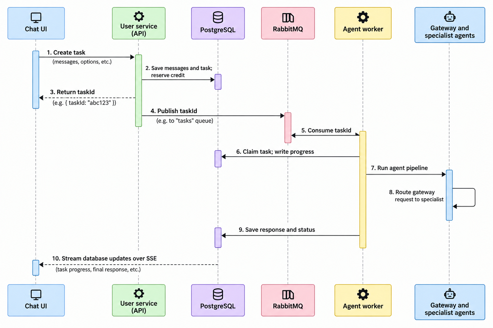

## Request flow

The upgrade separates **queueing a chat turn** from **running the agent pipeline**. RabbitMQ dispatches the whole turn to a worker. Inside that worker, the gateway can hand the request to a specialist agent. The specialist handoff happens within the agent pipeline; it does not create another RabbitMQ task.



## Frontend files

- [`ChatDetails.tsx`](/C:/Users/BCT-REN-2026-08-025/Desktop/CODING/Personal/Med_GPT/Client/src/components/ChatDetails.tsx) owns the chat interaction:
  - `sendMessage` submits the new task, replaces the optimistic message with the saved user and assistant messages, and starts watching the task.
  - `watchAgentTask` connects the stream callback to the UI.
  - `applyTaskStreamEvent` updates the assistant message and chat store as progress and text arrive.
  - The pending-task effect reconnects to an in-progress task after a refresh or revisit.
  - `handleStop` asks the server to cancel the task.

- [`chats.service.ts`](/C:/Users/BCT-REN-2026-08-025/Desktop/CODING/Personal/Med_GPT/Client/src/api/chats/chats.service.ts) implements the HTTP calls:
  - `createAgentTask` posts the user’s input and attachment IDs.
  - `streamAgentTask` reads the SSE response, parses events, and reconnects after transient stream failures.
  - `cancelAgentTask` posts the cancellation request.

- [`api.types.ts`](/C:/Users/BCT-REN-2026-08-025/Desktop/CODING/Personal/Med_GPT/Client/src/api/api.types.ts) defines the queued-task response and stream-event shapes. [`api/index.ts`](/C:/Users/BCT-REN-2026-08-025/Desktop/CODING/Personal/Med_GPT/Client/src/api/index.ts) adds the task, stream, and cancel route builders.

- [`Message.tsx`](/C:/Users/BCT-REN-2026-08-025/Desktop/CODING/Personal/Med_GPT/Client/src/components/Message.tsx) reads `generationStatus` and `progressMessage` from the assistant message metadata and displays the in-progress state.

## User service files

- [`message.service.ts`](/C:/Users/BCT-REN-2026-08-025/Desktop/CODING/Personal/Med_GPT/Server/user_service/src/services/message.service.ts)
  - `enqueueMessage` is the new background path. It checks chat ownership, reserves one credit, saves the user message, assistant placeholder, and `AgentTask` together, and snapshots the conversation context.
  - `sendMessage` remains the older synchronous path; the new chat UI uses `enqueueMessage`.
  - `deleteMessagePair` cancels an active task and refunds its credit before removing its messages.

- [`messageController.ts`](/C:/Users/BCT-REN-2026-08-025/Desktop/CODING/Personal/Med_GPT/Server/user_service/src/controllers/messageController.ts)
  - `enqueueMessage` validates the request and returns HTTP 202 with the task information.
  - `streamAgentTask` verifies task ownership, then streams the latest saved status and assistant content as SSE.
  - `cancelAgentTask` marks an active task cancelled and refunds its reserved credit.
  - The existing synchronous send and stream handlers remain available for the older routes.

- [`chat.routes.ts`](/C:/Users/BCT-REN-2026-08-025/Desktop/CODING/Personal/Med_GPT/Server/user_service/src/routes/chat.routes.ts) registers the create-task, task-stream, and cancel endpoints behind authentication.

- [`agent-task.publisher.ts`](/C:/Users/BCT-REN-2026-08-025/Desktop/CODING/Personal/Med_GPT/Server/user_service/src/services/agent-task.publisher.ts) bridges PostgreSQL and RabbitMQ:
  - `getChannel` creates a RabbitMQ confirm channel and durable queue connection.
  - `publishQueuedTasks` finds unpublished queued tasks, publishes persistent messages containing their task IDs, and marks confirmed tasks as published.
  - `recoverExpiredTasks` returns tasks with expired worker leases to the queueable state.
  - `compactCompletedTasks` runs conversation compaction for completed work.
  - `flush` runs those maintenance steps, and `startAgentTaskPublisher` starts the periodic loop.

- [`index.ts`](/C:/Users/BCT-REN-2026-08-025/Desktop/CODING/Personal/Med_GPT/Server/user_service/index.ts) starts the publisher during service startup.

- [`chat.service.ts`](/C:/Users/BCT-REN-2026-08-025/Desktop/CODING/Personal/Med_GPT/Server/user_service/src/services/chat.service.ts) cancels active tasks and refunds their credits when a chat is deleted.

- [`message.dto.ts`](/C:/Users/BCT-REN-2026-08-025/Desktop/CODING/Personal/Med_GPT/Server/user_service/src/dto/message.dto.ts) and [`message.mapper.ts`](/C:/Users/BCT-REN-2026-08-025/Desktop/CODING/Personal/Med_GPT/Server/user_service/src/mapper/message.mapper.ts) carry `agentType` and metadata through chat responses, so the UI can restore pending generation state.

## Agent service files

- [`worker.ts`](/C:/Users/BCT-REN-2026-08-025/Desktop/CODING/Personal/Med_GPT/Server/Agent_backend_service/worker.ts) is the background RabbitMQ consumer:
  - `runConsumer` connects, declares the queue, and starts consuming with a prefetch of one task.
  - `handleDelivery` validates each queue message and acknowledges it after processing.
  - `processTask` claims the database task, starts a lease heartbeat and cancellation check, runs the agent pipeline, and persists progress and response content.
  - `updateProgress` updates task state and assistant metadata together.
  - `retryOrFail` requeues retryable failures and records terminal failures, refunding the reserved credit.
  - `main` connects to the database before starting the consumer.

- [`src/agents/index.ts`](/C:/Users/BCT-REN-2026-08-025/Desktop/CODING/Personal/Med_GPT/Server/Agent_backend_service/src/agents/index.ts) contains the pipeline:
  - `streamAgentPipeline` consumes agent SDK events, emits routing and specialist progress, and yields response text as token chunks.
  - It suppresses gateway narration after a handoff so the UI receives the specialist’s answer as the final response.
  - If the gateway says it is transferring the request but does not actually invoke a handoff, it selects and runs a specialist fallback.
  - `runAgentPipeline` remains the non-streaming version.

- [`gateway.agent.ts`](/C:/Users/BCT-REN-2026-08-025/Desktop/CODING/Personal/Med_GPT/Server/Agent_backend_service/src/agents/gateway/gateway.agent.ts) configures the available handoffs. `selectFallbackAgent` chooses a specialist when the gateway did not trigger a real SDK handoff.

## Persistence and deployment

- [`schema.prisma`](/C:/Users/BCT-REN-2026-08-025/Desktop/CODING/Personal/Med_GPT/Server/user_service/prisma/schema.prisma) defines `AgentTask` with its input, saved context, message relations, lifecycle status, attempts, and lease timestamps. The matching agent-service schema lets its Prisma client use the same model.
- [`migration.sql`](/C:/Users/BCT-REN-2026-08-025/Desktop/CODING/Personal/Med_GPT/Server/user_service/prisma/migrations/20261026100000_agent_tasks/migration.sql) creates that table, indexes, and foreign keys.
- [`docker-compose.yml`](/C:/Users/BCT-REN-2026-08-025/Desktop/CODING/Personal/Med_GPT/docker-compose.yml) adds RabbitMQ and a separate `agent-worker` process. User service and worker connect to RabbitMQ; the durable RabbitMQ volume preserves its queue data.
- The service environment schemas require `RABBITMQ_URL`; [`README.md`](/C:/Users/BCT-REN-2026-08-025/Desktop/CODING/Personal/Med_GPT/README.md) and [`.env.example`](/C:/Users/BCT-REN-2026-08-025/Desktop/CODING/Personal/Med_GPT/.env.example) document the needed configuration.

The important recovery boundary is PostgreSQL: it stores the task and response, while RabbitMQ carries task IDs for delivery. SSE reads saved state from PostgreSQL, so a browser can reconnect without needing the original stream connection.

**Redis is not part of this implementation.** There is an `ioredis` dependency and a Redis caching comment elsewhere, but this task flow has no Redis connection, cache, or Compose service.

## Pubsub Architecture in RabbitMQ

```
https://chatgpt.com/share/6ae70d9e-a934-83ee-8ea8-e0e86e386b31
```